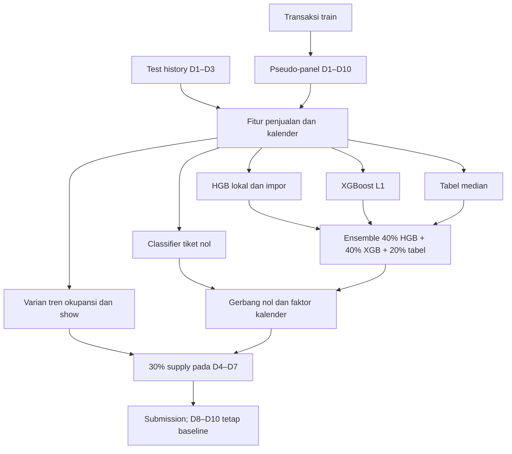

# JOINTSXINSPIRE UGM — Peramalan Tiket Bioskop D4–D10

(asset__joints/LB.png)

Proyek kompetisi JOINTS X INSPIRE UGM untuk memprediksi penjualan tiket harian pada hari ke-4 sampai ke-10 bagi setiap pasangan film dan klaster bioskop. Masukan saat inference adalah transaksi D1–D3, kalender, harga tiket, dan metadata yang diizinkan kompetisi.

Repositori publik ini menyimpan kode pipeline dan dokumentasi eksperimen. Dataset kompetisi, CSV submission, cache OOF, dan arsip eksperimen tetap berada di penyimpanan lokal. Tidak ada model baru yang dilatih saat pengemasan repositori ini.

## Hasil dan status artefak

| Kandidat | Public MASE terlapor | Artefak | Status |
|---|---:|---|---|
| Dani v7 | sekitar 0,475 | `submission_v7_patuh_lebaran_x150.csv`, lokal | Baseline champion; source notebook tersedia |
| Champion supply D4–D7, bobot 0,30 | **0,47313** | `submission_supply_hybrid_d4d7_w30.csv`, lokal | Pipeline tersedia; cache OOF disimpan lokal |
| Dani h5, Lebaran ×4,0 | **0,45717** | `diag_h5_v9_leb400.csv`, lokal | Public terbaik yang dilaporkan; source pembuat h5 belum tersedia |

Skor publik di atas dilaporkan selama kompetisi. Label D4–D10 test tidak tersedia, sehingga MASE test dan keunggulan pada private leaderboard tidak dapat dihitung ulang secara lokal. Sekitar 90% skor berasal dari private leaderboard menurut ketentuan yang dicatat dalam proyek.

`submission_best_validated.csv` dalam folder audit adalah **salinan champion**, bukan submission atau model baru.

## Pipeline yang digunakan

Pipeline champion yang dapat ditelusuri adalah:

1. [Inference_Terbaru_Dani.ipynb](KNOWLEDGE/Inference_Terbaru_Dani.ipynb): fungsi data, fitur, model, kalender, dan pascaproses Dani v7.
2. [buat_oof.py](KNOWLEDGE/eksperimen_supply_hybrid_2026/buat_oof.py): prediksi OOF baseline dan varian supply yang sepadan.
3. [validasi_blend.py](KNOWLEDGE/eksperimen_supply_hybrid_2026/validasi_blend.py): evaluasi campuran selektif dari cache OOF.
4. [buat_submission.py](KNOWLEDGE/eksperimen_supply_hybrid_2026/buat_submission.py): membandingkan baseline inference dengan CSV v7 sebelum membuat champion.



### Definisi dan fitur

- D1 test adalah tanggal awal tiga hari observasi yang berlaku bersama untuk seluruh klaster dalam satu film.
- Pada baseline champion, D1 pseudo-train ditentukan sebagai tanggal pertama ketika jumlah klaster aktif mencapai 50% puncak dalam 21 hari awal. Pasangan yang aktif pada D3 dipertahankan; target tanpa transaksi diisi nol.
- Fitur dasar memakai skala dan pola tiket D1–D3, hari aktif, label film lokal, kalender target, dan harga relatif.
- Model regresi memakai loss absolut pada rasio tiket terhadap skala. Classifier memberi peluang tiket nol; `p0 > 0.55` menghasilkan prediksi nol.
- Varian supply menambahkan dua fitur: `log1p(nilai D3) - log1p(rata-rata D1–D2)` untuk `occupation_rate` dan `total_show`. Definisi fitur sama untuk pseudo-train dan test history.
- Prediksi baseline dan supply masing-masing melewati gerbang nol, faktor kalender, serta pembulatan. Champion mencampurkan 70% baseline dan 30% supply pada D4–D7 lalu membulatkan `floor(pred + 0.5)`. D8–D10 memakai baseline penuh.
- Seed model champion adalah 0. Faktor inference v7 adalah level 1,15, libur sekolah 1,30, dan Lebaran 1,50 sesuai aturan pada notebook.

### Cabang Dani terbaru

[notebook_terbaru.ipynb](KNOWLEDGE/notebook_terbaru.ipynb) berasal dari JSON notebook lokal bernama `notebook_terbaru`, berisi 164 sel gabungan riset, notebook final, dan lampiran skrip. Ekstensi ditambahkan agar dapat dirender GitHub. Semua output sel dan execution count pada salinan notebook publik dikosongkan; kode dan markdown dipertahankan.

Kode final cabang ini memakai D1 60 hari, XGBoost depth 7, dan faktor Lebaran 2,00; baseline champion memakai D1 21 hari dan XGBoost depth 6. Sebagian output tersimpan pada notebook gabungan belum sinkron dengan kode finalnya. Notebook gabungan ini belum terverifikasi sebagai source CSV h5. Jangan menjalankan `Run All`: bagian lampiran berisi skrip tambahan yang dapat ikut mengeksekusi training atau pengambilan data eksternal.

## Metrik dan validasi

Definisi MASE kompetisi:

```text
scale(movie, cinema) = max(sum(ticket D1–D3) / 3, 1)
MASE = mean(abs(y_true - prediction) / scale)
```

Evaluasi historis champion memakai lima fold terpisah per film dan split waktu D1 sebelum/sesudah 1 Juli 2025. Pemisahan film memeriksa generalisasi ke film baru; split waktu memeriksa transfer periode. Weighted CV mengikuti komposisi skala dan lebar rilis test sebagai diagnosis tambahan, bukan metrik resmi. Split waktu telah dilihat selama pengembangan dan bukan holdout independen yang masih tertutup.

Hasil yang direproduksi dari cache pada audit sebelumnya:

| Kandidat | CV MASE | Weighted CV | Temporal MASE | Temporal weighted |
|---|---:|---:|---:|---:|
| Dani v7 OOF | 0,378009 | 0,491313 | 0,345563 | 0,411498 |
| Champion supply D4–D7 w0,30 | **0,377017** | **0,490504** | **0,344536** | **0,410331** |

Gain weighted CV champion adalah **0,000809 ± 0,000333 paired SE per film**; gain temporal weighted **0,001168 ± 0,000404**. Laporan lengkap: [eksperimen supply](KNOWLEDGE/eksperimen_supply_hybrid_2026/LAPORAN.md). Nilai SE tersebut bukan standar deviasi antar-fold. Mean dan standar deviasi skor per fold belum tersimpan dalam tabel ini.

## Dataset

Dataset tidak dipublikasikan. Untuk menjalankan source secara lokal, letakkan berkas berikut dalam `KNOWLEDGE/dataset/`.

| File | Isi |
|---|---|
| `train.csv` | Transaksi harian April–September 2025; sumber pseudo-target berlabel |
| `test_history.csv` | Transaksi D1–D3 film test |
| `test.csv` | ID, film, klaster, kota, tanggal D4–D10; tidak memiliki label target |
| `sample_submission.csv` | Template `id,total_ticket` |
| `movies.csv` | Metadata film |
| `holidays.csv` | Kalender dan hari libur |
| `ticket_prices.csv` | Harga tiket menurut kota dan jenis hari |

Source menggunakan nama file dan kolom asli. Dataset, CSV submission, dan cache evaluasi tidak disertakan dalam repo publik ini.

## Menjalankan kode

Dependensi yang terlihat dari import tersedia pada [requirements.txt](requirements.txt). Lockfile environment champion asli tidak tersedia. Daftar tersebut tidak menjamin reproduksi bit demi bit dengan versi library lain.

Mulai dari root repositori. Evaluasi cache tanpa training:

```bash
python KNOWLEDGE/eksperimen_supply_hybrid_2026/validasi_blend.py
```

Perintah ini memerlukan cache lokal `KNOWLEDGE/eksperimen_supply_hybrid_2026/oof_dani_supply.npz`, yang tidak diunggah ke repo publik. Perintah menulis ulang tabel evaluasi pada direktori eksperimen supply; gunakan salinan kerja untuk mempertahankan output historis.

Urutan pembuatan ulang OOF dan submission yang ditentukan source:

```bash
python KNOWLEDGE/eksperimen_supply_hybrid_2026/buat_oof.py
python KNOWLEDGE/eksperimen_supply_hybrid_2026/validasi_blend.py
python KNOWLEDGE/eksperimen_supply_hybrid_2026/buat_submission.py
```

**Reproduksi training saat ini belum lengkap.** Dua skrip training membutuhkan snapshot `KNOWLEDGE/dataset/external/wiki_daftar_film_indonesia_2025_oldid27901699.wikitext`. File itu tidak ditemukan dalam dataset maupun arsip yang tersedia; skrip akan berhenti pada assertion. Label ini dipakai pipeline champion historis. Jangan menggantinya dengan snapshot baru tanpa mengaudit cutoff dan memeriksa ulang hasil. Skrip submission juga membutuhkan CSV lokal `KNOWLEDGE/submission_v7_patuh_lebaran_x150.csv` dan memverifikasi baseline harus cocok persis dengannya sebelum melanjutkan. CSV tersebut sengaja tidak dipublikasikan.

Saat pengemasan 9 November 2026, `.venv_seed` lokal terblokir Application Control. Training maupun evaluasi Python tidak dijalankan ulang. Angka di README berasal dari laporan historis yang disertakan dan cache lokal, bukan run model baru.

## Struktur repositori

```text
README.md
requirements.txt
MANIFEST_SHA256.csv
KNOWLEDGE/
  Inference_Terbaru_Dani.ipynb
  notebook_terbaru.ipynb
  eksperimen_supply_hybrid_2026/
    buat_oof.py
    validasi_blend.py
    buat_submission.py
    LAPORAN.md
  PENGETAHUAN.md
  RANGKUMAN_SEMUA_PERCOBAAN.md
  audit_artefak_lanjutan_2026/
  final_mase_optimization/
```

Tiga skrip dan laporan champion dipulihkan dari ZIP lokal ke path aslinya. Data, cache, ZIP, environment lokal, dan credential tidak dimasukkan.

## Temuan eksperimen

[RANGKUMAN_SEMUA_PERCOBAAN.md](KNOWLEDGE/RANGKUMAN_SEMUA_PERCOBAAN.md) merangkum fitur internal, gerbang nol, tuning, adaptasi domain, kalender, dan data eksternal yang pernah diuji. [PENGETAHUAN.md](KNOWLEDGE/PENGETAHUAN.md) menjelaskan keputusan historis. Path artefak dalam laporan lama dapat merujuk ke file lokal atau ZIP yang tidak dipublikasikan.

[Audit optimasi terakhir](KNOWLEDGE/final_mase_optimization/FINAL_REPORT.md) menemukan tidak ada kandidat baru yang cukup kuat untuk menggantikan champion menurut protokol lokal. Penurunan level output memberi gain eksploratif pada cache yang telah dipakai berulang kali; hasil tersebut tidak dianggap konfirmasi baru.

[Audit Lebaran](KNOWLEDGE/final_mase_optimization/LEBARAN_SENSITIVITY.md) menunjukkan h5 dan v7 identik sebelum 21 Maret 2026. Sebanyak 2.971 baris berubah sesudahnya, semuanya naik, tetapi hubungan pembulatan tidak sepenuhnya konsisten dengan sekadar mengganti satu faktor pada prediksi mentah yang sama. Source h5 diperlukan untuk reproduksi penuh.

## Integritas dan batas reproduksi

[MANIFEST_SHA256.csv](MANIFEST_SHA256.csv) mencatat hash dan ukuran setiap berkas publik. Notebook publik memiliki output kosong. File sumber lokal, submission, dataset, dan ZIP tetap utuh.

Hal yang belum terverifikasi: reproduksi training pada environment baru, snapshot label lokal yang hilang, source h5, label test, skor private, dan hak distribusi publik dataset. Tidak ada AutoML atau AI API pada inference pipeline yang tersedia. Data eksternal historis mengikuti batas 30 September 2025; paket ini tidak mengambil data eksternal baru.
